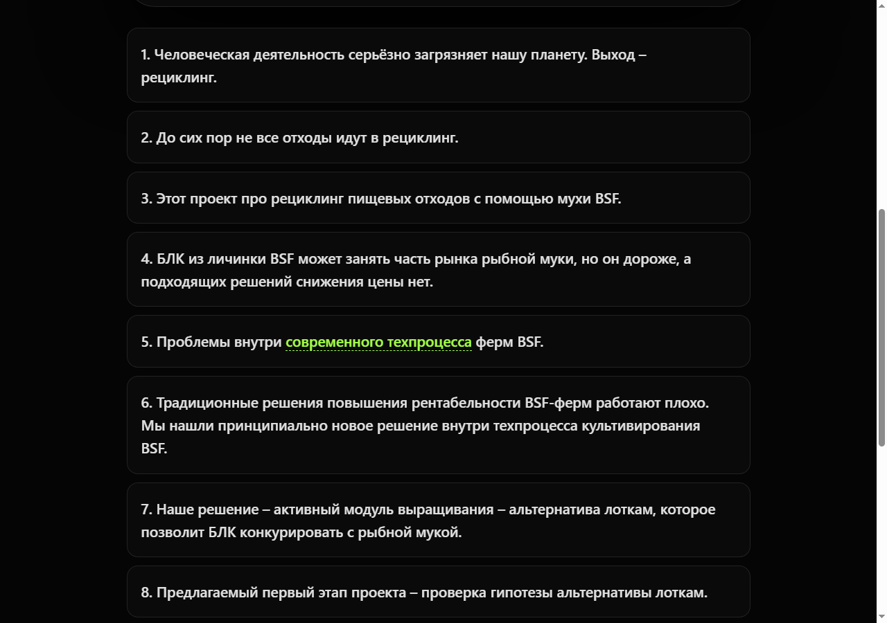
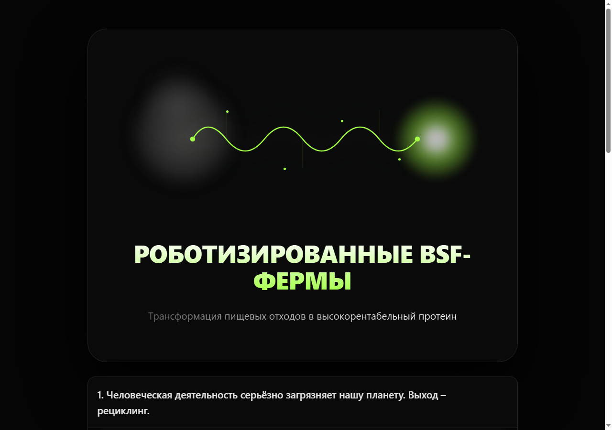
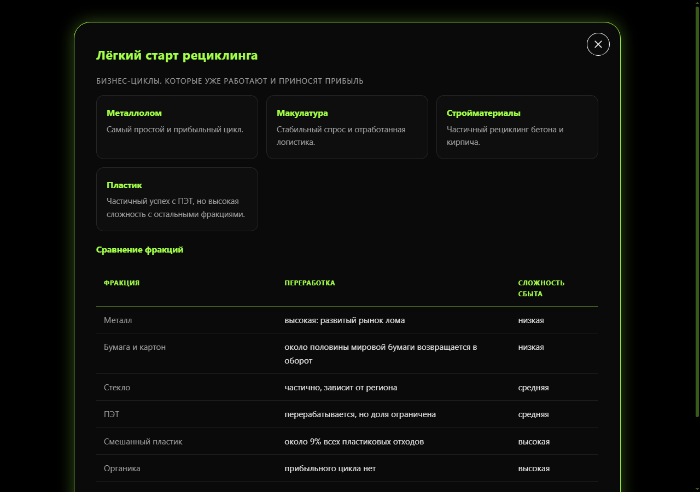
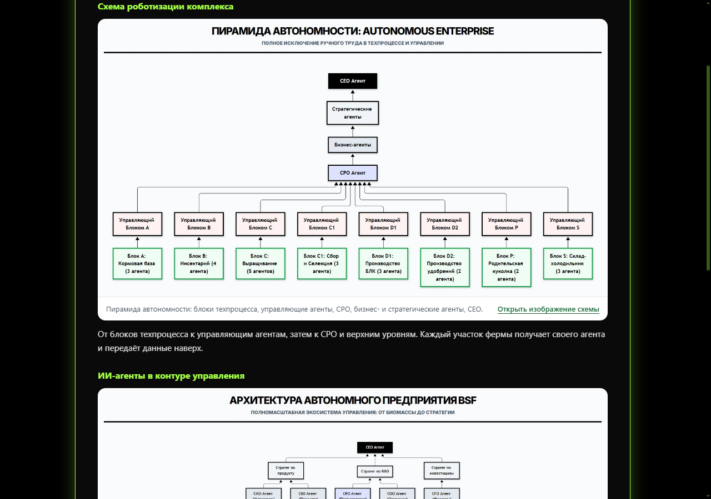
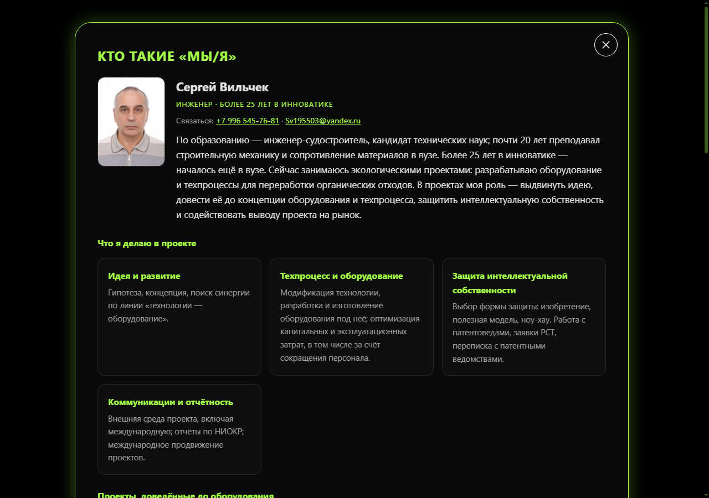

# Живая книга проекта

Интерактивная энциклопедия проекта, которая растёт вместе с ним. Первый экземпляр — книга проекта
«ИИ-ферма для BSF»: 13 глав, обложка, содержание и модальные окна со схемами, таблицами и
фотографиями.

## Идея

Инноватор ведёт несколько проектов одновременно. Проекты «живые»: развиваются, меняют направление,
дополняются и сокращаются. Показывать их приходится разным аудиториям — партнёрам, инвесторам,
команде, кураторам — в разном формате и с разной глубиной.

Книга решает это как энциклопедия проекта:

- в ней собраны основные сведения о проекте — от проблемы до экономики и запроса;
- она «живая», как сам проект: главы правятся, добавляются новые, книга периодически переиздаётся
  для внутреннего и внешнего пользования;
- из неё ИИ-агент сможет извлекать материалы для презентаций, докладов и публикаций.

Первая книга — проект BSF. Универсальный скилл `interactive-book-builder` позволяет собрать такую же
книгу для любого другого проекта.

## Что умеет

- показывает обложку, содержание и 13 глав в браузере;
- раскрывает главы по клику, открывает окна со схемами, таблицами, расчётами и фотографиями;
- позволяет править каждую главу в отдельном файле, не затрагивая остальные;
- собирает книгу из глав одной командой и переиздаёт её после правок;
- вставляет новую главу между существующими без перенумерации;
- собирает пакет для читателя: папку, одиночный HTML-файл и ZIP;
- проверяет ссылки и окна автоматически в браузере.

## Скриншоты

| | |
|---|---|
|  |  |
| Обложка книги | Содержание |
|  |  |
| Раскрытая глава | Окно с таблицей |
|  |  |
| Схема в окне | Фотографии и карточка автора |

## Презентация к защите

- [Открыть презентацию в браузере](https://sergius-nsk.github.io/living-project-book/presentation/defense-living-project-book.html) —
  9 слайдов, управление стрелками, `F` — полный экран.
- [Скачать PDF](https://sergius-nsk.github.io/living-project-book/presentation/defense-living-project-book.pdf) —
  та же презентация для отправки.

Файлы лежат в папке `presentation/` и публикуются вместе с книгой на GitHub Pages.

## Быстрый старт

Программы устанавливать не нужно — книга открывается в браузере.

1. Откройте `Landing-book/index.html` двойным щелчком.
2. Щёлкните по обложке — откроется содержание.
3. Щёлкните по названию главы — раскроются параграфы.
4. Слова, выделенные цветом и пунктиром, открывают окна.

Готовую версию для отправки собирает скрипт упаковки: папка и ZIP с книгой и инструкцией
для получателя. В репозитории её нет — она создаётся заново под каждую переиздаваемую версию.

## Структура репозитория

```
Landing-book/
  index.html              — книга; собирается из глав
  _shared/                — общий каркас: стили, движок окон
  cover/                  — обложка: стили и разметка
  chapter-01/ … chapter-13/
    glava-N.html          — данные главы и её окна
    content.md            — описание главы для человека
  assets/img/             — изображения
scripts/
  assemble-book.js        — сборка книги из глав
  build-book-dist.ps1     — упаковка для отправки (Windows)
  probe-browser.js        — проверка в браузере
  check-js.js             — проверка синтаксиса встроенных скриптов
  make-screenshots.js     — скриншоты книги для README
  shot-chapter.js         — скриншоты отдельной главы
screenshots/              — снимки для README
.claude/skills/interactive-book-builder/
                          — универсальный скилл для создания таких книг
project-description.md    — описание по структуре задания
```

## Как править главу

Каждая глава — отдельный файл `Landing-book/chapter-NN/glava-N.html`. Он открывается в браузере
как самостоятельная страница: обложка → содержание → глава. Так видно результат правки сразу.

1. Откройте файл главы в браузере.
2. Измените текст в блоке `chapter-data`:

```html
<script type="application/json" id="chapter-data">
{
  "order": 1,
  "title": "Название главы одной фразой",
  "ready": true,
  "content": [
    {
      "title": "Первый параграф",
      "theses": [
        "Тезис без ссылки.",
        {
          "text": "Тезис со ссылкой на окно: нажмите на ссылку.",
          "links": [{ "label": "ссылку", "modal": "exampleModal" }]
        }
      ]
    }
  ]
}
</script>
```

3. Окна этой главы находятся между маркерами `<!-- CHAPTER-MODALS:START -->` и `<!-- CHAPTER-MODALS:END -->`.
4. Пересоберите книгу (см. ниже).

Правила:

- `order` задаёт место в книге. Целые 1, 2, 3…; чтобы вставить главу между 3 и 4, поставьте `3.5`.
  В книге нумерация всегда сквозная: 1, 2, 3… — дробные значения не показываются.
- `label` ссылки должен встречаться в тексте тезиса — по этому слову ставится ссылка.
- `id` окон уникальны на всю книгу.
- Пути к изображениям в главе — `../assets/...`; при сборке они превращаются в `assets/...`.

## Сборка книги

```bash
node scripts/assemble-book.js                # проверка: список глав и порядок, без записи
node scripts/assemble-book.js --write        # пересобрать Landing-book/index.html
```

Сборщик находит главы по маркерам, сортирует по `order`, заменяет массив глав и область окон.
Если глав в файлах меньше, чем сейчас в книге, он отказывается писать без `--force` — защита
от случайной потери текста.

## Упаковка для отправки

Windows:

```powershell
powershell -ExecutionPolicy Bypass -File scripts\build-book-dist.ps1 -PackageName bsf-book-review
```

Получается `dist/<имя>/` с `index.html`, `index-standalone.html`, папками `assets` и `cover`,
инструкцией `README.txt`, а также ZIP-архив.

## Проверка

```bash
node scripts/probe-browser.js --file Landing-book/index.html
```

Скрипт открывает книгу в headless Chrome, раскрывает каждую главу, нажимает каждую ссылку
и сообщает, какие окна не открылись или не закрылись. Выход `0` — всё в порядке.

Проверка синтаксиса встроенных скриптов:

```bash
node scripts/check-js.js Landing-book/index.html
```

## Скилл: `interactive-book-builder`

В `.claude/skills/interactive-book-builder/` лежит скилл для Claude Code — инструкция, по которой
ИИ-агент создаёт такие же книги для других проектов.

**Назначение.** Передать опыт, накопленный на первой книге, чтобы автор и другие инноваторы
могли делать «живые книги» для своих проектов: не одним монолитом, а набором глав, с общей
обложкой, сборкой и проверкой.

**Что умеет:**

- разворачивает каркас книги: `book/`, `_shared/`, `cover/`, первую главу, скрипты;
- задаёт формат главы: JSON с заголовком, порядком, параграфами, тезисами и ссылками на окна;
- собирает книгу из глав и подставляет окна;
- вставляет главу между существующими без перенумерации — порядок задаёт поле `order`;
- собирает пакет: папку, одиночный `index-standalone.html` и ZIP;
- проверяет книгу в реальном браузере: раскрывает главы, нажимает ссылки, сообщает о сбоях;
- хранит обложку отдельно, чтобы менять её независимо от каркаса.

**Состав скилла:**

```
interactive-book-builder/
  SKILL.md                  — когда применять и как работать
  references/
    architecture.md         — структура файлов, формат главы, правила нумерации
    workflow.md             — сценарии: новая книга, правка, вставка, миграция, публикация
    pitfalls.md             — типичные ошибки и обходы
    verification.md         — автоматическая проверка книги
  scripts/
    scaffold-book.js        — каркас новой книги
    assemble-book.js        — сборка книги из глав
    package-book.js         — упаковка для отправки
    probe-browser.js        — проверка в браузере
  assets/templates/         — шаблоны страниц, стилей и обложки
```

**Как пользоваться.** Скопировать папку в `~/.claude/skills/` (или установить архив `.skill`)
и попросить агента: «сделай интерактивную книгу по проекту …». Дальше агент работает по скиллу:
создаёт каркас, наполняет главы, собирает и упаковывает книгу. Обложку и оформление можно
перекрасить под проект — стили вынесены в отдельные файлы.

**Ограничения.** Книга статическая: работает локально в браузере, без сервера и базы данных.
Это осознанный выбор — такую книгу можно отправить архивом или одним файлом, и она откроется
у любого получателя.

## Технологии

- HTML5, CSS3, JavaScript (ES6) — без фреймворков и внешних библиотек;
- Node.js — сборка, упаковка, проверка; сторонних зависимостей нет;
- JSON — данные глав;
- Chrome DevTools Protocol — автоматическая проверка книги в браузере.

## Статус и планы

MVP готов: первая книга используется для подготовки материалов проекта BSF, скилл проверен
на чистом тестовом проекте.

Дальше:

- извлечение материалов для презентаций, докладов и публикаций по запросу ИИ-агента;
- шаблоны книг под разные типы проектов;
- публикация обновлённых версий книги в интернете.
